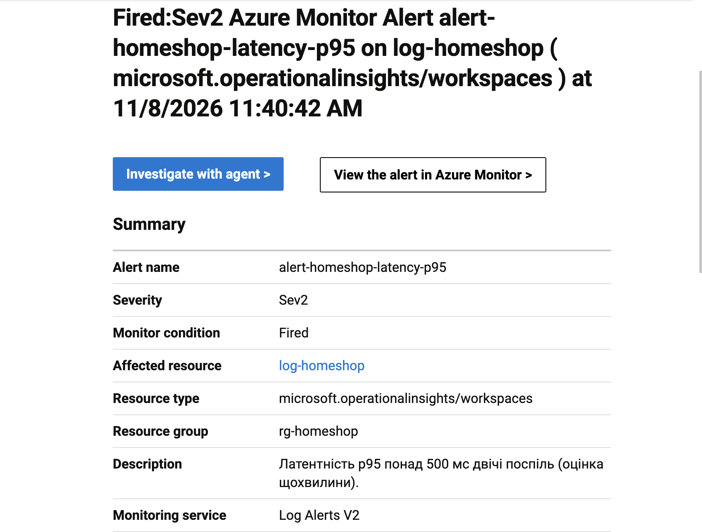
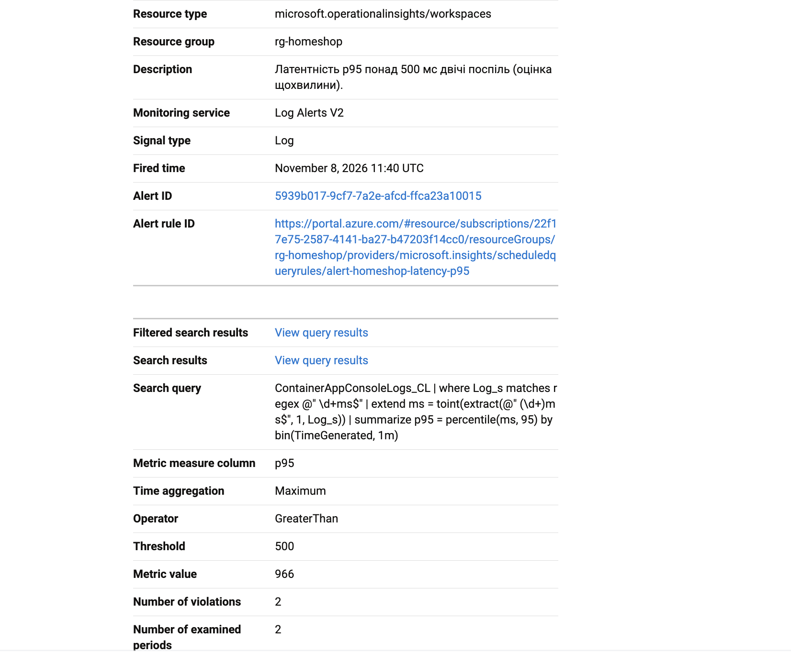
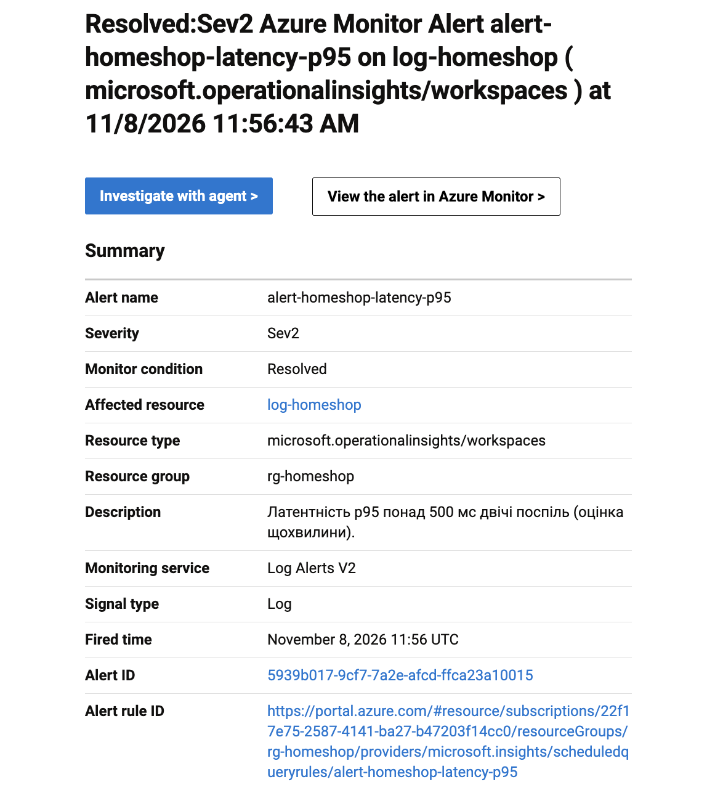
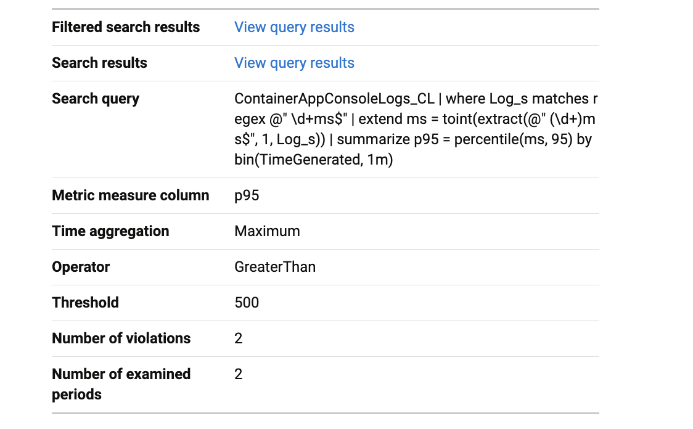
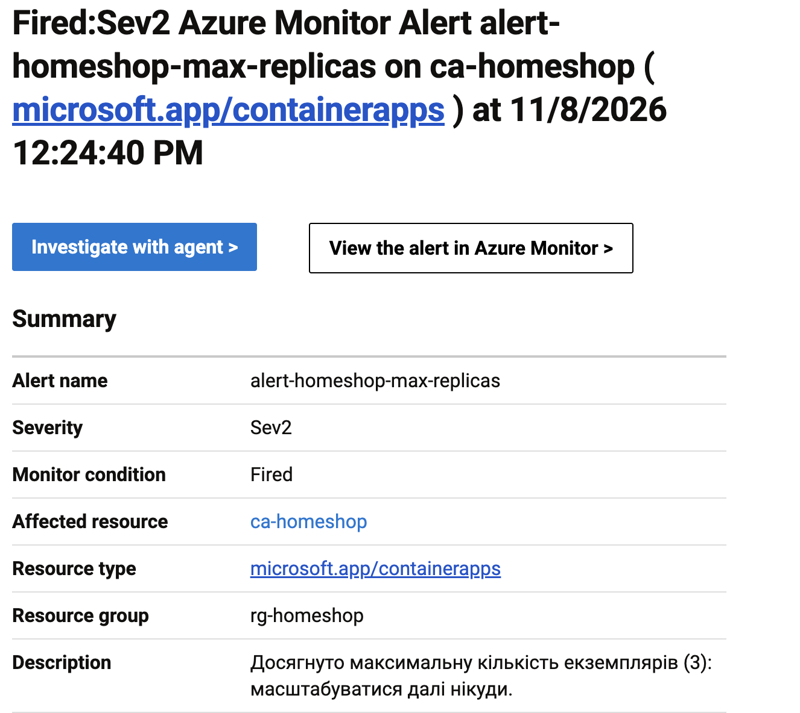
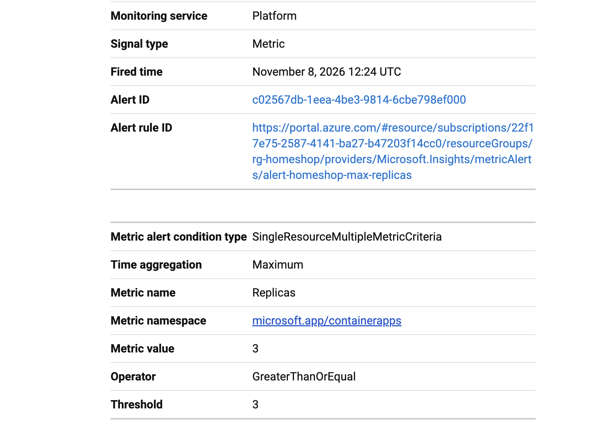

# Сповіщення

## Умова

Правило `alert-homeshop-latency-p95` (файл `infra/monitoring.tf`, ресурс `azurerm_monitor_scheduled_query_rules_alert_v2.latency`):

> p95 латентності відповідей понад **500 мс** на двох послідовних перевірках.

- Дані: журнал `ContainerAppConsoleLogs_CL` у Log Analytics; кожен запит застосунок логує з часом виконання (`GET /products 200 [HIT] 3ms`), p95 рахується запитом KQL по хвилинних відрізках.
- Перевірка щохвилини (`evaluation_frequency = PT1M`) за вікно 5 хвилин, спрацьовує, коли умова виконана двічі поспіль (`2 з 2`).
- Канал доставки: група дій `ag-homeshop-email` з поштою власника (`azurerm_monitor_action_group`). Другий лист надсилається автоматично, коли умова зникає (`auto_mitigation_enabled = true`).

Додатково налаштовані алерти «досягнуто максимум екземплярів (3)» і «відповіді 5xx» (метрики Container Apps). Під час тесту вони не спрацювали: застосунок не повертав помилок і не піднявся до трьох екземплярів.

### Чому саме латентність

Користувач бачить повільну відповідь, а не відсоток CPU. Тест це довів: при 150 користувачах CPU застосунку тримався ~55 % (нижче будь-якого порога CPU), а p95 виріс до 914 мс через базу даних. Алерт на CPU мовчав би, алерт на латентність спрацював. Поріг 500 мс узято з завдання; нормальний p95 нашого сервісу 80–120 мс, тож 500 мс це явне погіршення, а не коливання.

### Чому «двічі поспіль», а не миттєво

Одиночний сплеск (холодний старт нового екземпляра, перша хвилина наростання) не вимагає втручання. Без умови тривалості алерт «блимав» би (flapping): тривога, норма, тривога, і лист за кожним коливанням.

## Результат прогону (150 користувачів, 11:32–11:42 UTC)

| Час (UTC) | Подія |
|---|---|
| 11:32:29 | Початок наростання |
| 11:35:00 | Вихід на сталі 150 користувачів |
| ~11:37–11:38 | p95 перетнув 500 мс (за графіком дашборда) |
| 11:38:30 | Правило створено (під час прогону, через зміну умови) |
| **11:40:42** | **Лист «Fired»** (`img/alert-fired.png`) |
| 11:42:00 | Кінець тесту, p95 швидко падає нижче 500 мс |
| **11:56:43** | **Лист «Resolved»** (`img/alert-resolved.png`) |

Лист «Fired» (13:40 за київським часом):




Той самий вміст текстом:

```
Fired:Sev2 Azure Monitor Alert alert-homeshop-latency-p95 on log-homeshop at 11/8/2026 11:40:42 AM
Alert name              alert-homeshop-latency-p95
Severity                Sev2
Monitor condition       Fired
Monitoring service      Log Alerts V2
Description             Латентність p95 понад 500 мс двічі поспіль (оцінка щохвилини).
Time aggregation        Maximum
Operator                GreaterThan
Threshold               500
Metric value            966
Number of violations    2
Number of examined periods  2
```

На момент спрацювання p95 дорівнював **966 мс** за порогу 500: обидві з двох перевірок виявили перевищення.

Лист «Resolved» (13:56 за київським часом):




Той самий вміст текстом:

```
Resolved:Sev2 Azure Monitor Alert alert-homeshop-latency-p95 on log-homeshop at 11/8/2026 11:56:43 AM
Alert name              alert-homeshop-latency-p95
Monitor condition       Resolved
Monitoring service      Log Alerts V2
Operator                GreaterThan
Threshold               500
Number of violations    2
Number of examined periods  2
```

Той самий `Alert ID` (5939b017-…) у обох листах показує, що це одна й та сама тривога: спершу `Fired`, потім `Resolved`.

Час від початку сталого навантаження до першого листа: **5 хв 42 с**. Правило було створене на 2 хвилини 12 секунд раніше за лист, тож у штатному режимі (правило діє заздалегідь) реакція склала б близько 5–6 хвилин: ~2–3 хв на те, щоб p95 перетнув поріг, і ще 2–3 хв на затримки нижче.

Лист про повернення до норми прийшов через ~14 хвилин після кінця тесту: p95 впав нижче 500 мс за хвилину, але правило дивиться на вікно 5 хвилин і закриває тривогу лише тоді, коли поріг не перевищується у всьому вікні.

## Другий алерт: досягнуто максимум екземплярів

Правило `alert-homeshop-max-replicas` (метрика `Replicas`, агрегація `Maximum`, умова `≥ 3`, вікно 5 хвилин, перевірка щохвилини) спрацювало під час прогону з чергою (12:19–12:29 UTC):

| Час (UTC) | Подія |
|---|---|
| 12:19:36 | Початок прогону на 150 користувачів |
| 12:22 | API піднявся до 3 екземплярів (розклад дає 2, CPU додає третій) |
| **12:24:40** | **Лист «Fired»**: `Metric value 3`, `Operator GreaterThanOrEqual`, `Threshold 3` |
| 12:43 | Лист «Resolved» (після повернення до 2 екземплярів) |

Лист «Fired» для цього правила:




Від досягнення максимуму до листа минуло ~2,5 хвилини: метричні алерти надходять швидше, ніж алерти за журналом, бо не чекають на збирання логів у Log Analytics.

## З чого складається затримка

1. Журнал застосунку потрапляє в Log Analytics із затримкою ~2–5 хвилин (збирання, обробка).
2. Правило перевіряється раз на хвилину.
3. Умова вимагає двох перевірок поспіль (мінімум ще ~1 хвилина).
4. Доставка листа службою Azure: до хвилини.

## Чи прийнятний такий час реакції

Для повільної роботи магазину так: кілька хвилин погіршення не руйнують бізнес, а проблема тривала, тому лист дає час діяти. Для аварії, коли сайт взагалі не відповідає, ні: 5–6 хвилин простою на пікові години це втрачені замовлення. Для таких випадків потрібен швидший сигнал: метричний алерт на кількість 5xx або на стан `/health` (метрики Azure Monitor надходять із затримкою ~1 хвилина, у цій роботі такий алерт на 5xx налаштований). У реальному сервісі я б залишив обидва: метричний алерт для швидкої реакції на аварію і алерт на p95 для виявлення повільної деградації.
