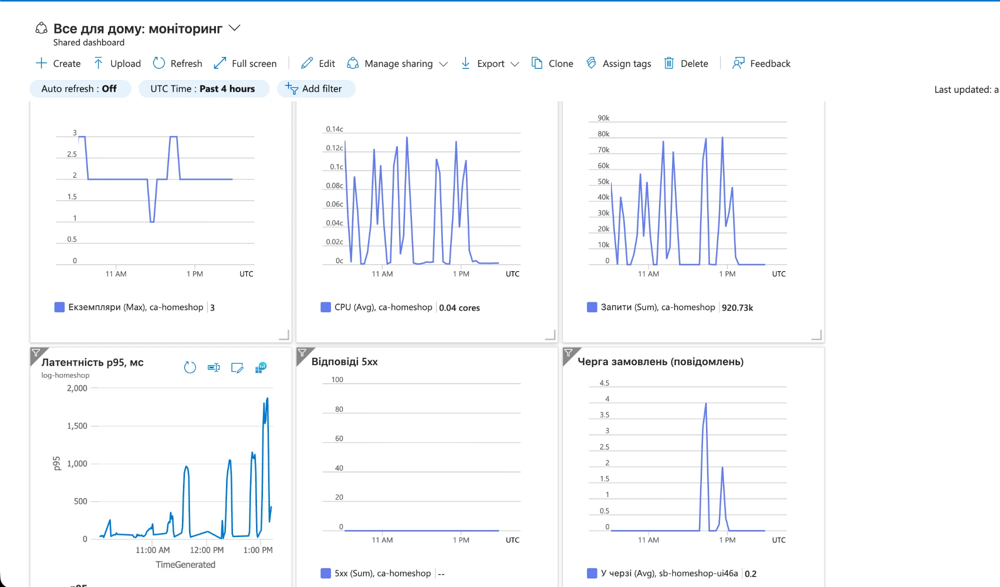

# Автоматичне масштабування

## Параметри політики

Задаються в `infra/app.tf`, блок `template` ресурсу `azurerm_container_app.shop`.

| Параметр | Значення | Чому |
|---|---|---|
| `min_replicas` | 1 | Сервіс має відповідати завжди; нуль дав би холодний старт на першому запиті |
| `max_replicas` | 3 | Ліміт лаби 3–4; більше екземплярів не допоможе, бо вузьким місцем стає база B1ms (кожен екземпляр відкриває до 10 з'єднань, ще один екземпляр лише додав би навантаження на неї) |
| Метрика | CPU, `Utilization`, цільове 60 % | Застосунок ходить в БД, але одночасно хешує паролі (scrypt) і серіалізує JSON, тому CPU росте разом із навантаженням |
| `cooldown_period_in_seconds` | 300 | Скільки платформа чекає після спаду метрики перед тим, як прибрати екземпляри |

CPU вимірюється відносно запиту ресурсів контейнера (0,25 ядра). 60 % означає ~0,15 ядра на екземпляр.

### Чому саме 60 %

- Залишає запас 40 %: поки з'являється новий екземпляр (десятки секунд), існуючі ще витримують сплеск.
- 80–90 % було б надто пізно: екземпляр уже насичений, латентність росте раніше, ніж новий встигає стартувати.
- 30–40 % давало б зайві екземпляри й гроші.

## Період стабілізації (cooldown)

Це пауза після останнього перевищення порогу, протягом якої платформа не зменшує кількість екземплярів. Метрика навантаження шумна, тому одна хвилина тиші не означає, що навантаження зникло.

Якщо cooldown = 0:

- екземпляри додаються й прибираються одразу за кожним коливанням метрики (flapping);
- кожне вилучення обриває запити, які екземпляр ще обробляв;
- кожен новий екземпляр знову відкриває з'єднання з базою й проходить холодний старт;
- платимо за постійні запуски й зупинки без користі.

## Результати прогону

Усі моменти нижче взято з метрик Azure Monitor (час UTC) під час двох прогонів сценарію з `docs/LOADTEST.md`.

### Прогін 100 користувачів (11:15–11:25 UTC)

| Час | Подія |
|---|---|
| 11:15 | Початок навантаження, 1 екземпляр, CPU ~2 % |
| 11:17 | CPU 61 %: перетнув цільові 60 % |
| 11:18 | З'явився 2-й екземпляр, CPU впав до 57 % |
| 11:25 | Навантаження закінчилось |
| 11:31 | Лишився 1 екземпляр (через ~6 хв після кінця) |

### Прогін 150 користувачів (11:32–11:42 UTC)

| Час | Подія |
|---|---|
| 11:32:29 | Початок наростання від 0 до 150 користувачів |
| 11:34 | CPU 61 %: перетнув поріг |
| 11:35 | З'явився 2-й екземпляр; саме о 11:35:00 навантаження вийшло на 150 користувачів |
| 11:35–11:41 | Стале навантаження: 2 екземпляри, CPU 49–59 %, ~14 тис. запитів за хвилину |
| 11:42 | Навантаження закінчилось |
| 11:49 | Лишився 1 екземпляр (через 7 хв після кінця) |

Знімок дашборда за 4 години (усі прогони видно окремими піками):

Як читати знімок (час UTC, шкала внизу кожного графіка):
- **Екземпляри** (ліва верхня плитка): вихід на 2, короткий підйом до 3 під перевантаженням і повернення до 2 (вдень діє розклад «мінімум 2»); коротка «яма» до 1 це момент перемикання на нічне вікно під час перевірки розкладу.
- **CPU** (середня верхня плитка): кожен прогін це окремий пік; між піками CPU майже 0.
- **Запити за хвилину** (права верхня плитка): піки збігаються з піками CPU, тобто навантаження росте разом із запитами.
- **Латентність p95** (ліва нижня плитка): під великим навантаженням (останні прогони) p95 доходить до ~1800 мс.
- **Відповіді 5xx**: пряма лінія на нулі, помилок не було.
- **Черга замовлень**: піки до 4 повідомлень під час прогонів у режимі черги.

### Чому між перетином порогу і новим екземпляром минає час

1. CPU вимірюється й усереднюється за хвилину, тому поріг видно із запізненням.
2. Платформа опитує метрику не безперервно, а з інтервалом (30 с).
3. Новий екземпляр треба запустити: створити контейнер, завантажити образ, дочекатись проби `/health` (readiness). Це ще десятки секунд, і весь цей час існуючі екземпляри працюють під повним навантаженням.

### Чому екземпляри прибираються значно пізніше за падіння навантаження

Платформа тримає період стабілізації 300 с, а потім ще перевіряє метрику. Навантаження зникло об 11:42, а екземпляр прибрано об 11:49. Це свідомо: додавання пом'якшує біль, а зайвий екземпляр коштує копійки, тоді як передчасне прибирання перед наступною хвилею дало б ще один холодний старт і обрив запитів.

### Що показав тест

Під 150 користувачами CPU залишався ~55 %, тобто нижче цілі, і третій екземпляр не з'явився, хоча p95 виріс до 914 мс. Вузьким місцем стала база (B1ms), а не процесор застосунку. Це приклад до питання 2: CPU поганий показник для сервісу, який здебільшого чекає на базу. Кращі метрики: кількість одночасних HTTP-запитів на екземпляр (правило `http` у Container Apps) або сама латентність.
