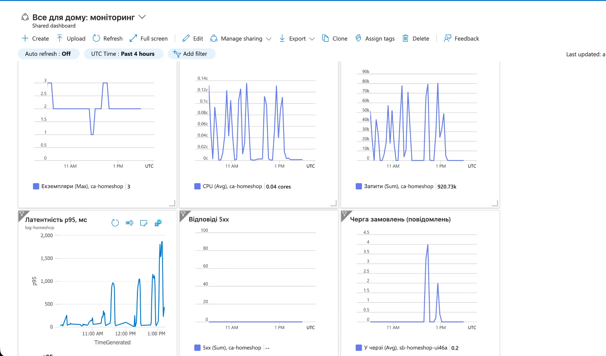

# Асинхронна обробка через чергу

## Як це влаштовано

Запис замовлення винесено з запиту в чергу Azure Service Bus (`infra/servicebus.tf`, SKU Basic, черга `orders`).

```
Клієнт → POST /orders → API: запис order_requests (pending) + повідомлення в чергу → 202 Accepted
                                                    │
                                    Service Bus (черга orders)
                                                    │
        Обробник (окремий контейнер ca-homeshop-worker) ← читає, створює замовлення в транзакції
                                                    │
                     order_requests.status = done, order_id = ...
```

- API: `app/src/orders.js` (`submitOrder`), `app/src/queue.js`.
- Обробник: `app/src/worker.js`, той самий образ, команда `node src/worker.js`, без публічного входу (`infra/worker.tf`).
- Режим перемикається змінною `ORDERS_MODE`: `queue` (чергою, відповідь 202) або `direct` (запис у базу одразу, відповідь 201). Це дозволило порівняти обидва режими на одному й тому самому коді.

## Що змінилось для клієнта

| | Прямий режим | Черга |
|---|---|---|
| Відповідь на `POST /orders` | `201 Created` + готове замовлення | `202 Accepted` + `request_id` і `status_url` |
| Що це означає | замовлення створено | замовлення прийнято, але ще не створено |
| Номер замовлення | у відповіді | з'являється пізніше |

Код `202` чесно каже: «запит прийнято, результат буде пізніше». Клієнт не може одразу показати номер замовлення.

## Як клієнт дізнається результат

Опитуванням: `GET /orders/requests/{request_id}` повертає

- `pending`: ще в черзі або в обробці;
- `done` і `order_id`: замовлення створено;
- `failed` і `error`: обробити не вдалося (наприклад, невідомий товар), повтор не допоможе.

Фронтенд (`app/public/app.js`, функція `waitForOrder`) опитує раз на секунду до 30 разів і показує «Замовлення №… оброблено». Альтернативи: webhook чи WebSocket із сервера, але для магазину опитування достатньо.

## Доставка «щонайменше один раз» і повторна обробка

Service Bus гарантує, що повідомлення дійде **принаймні раз**. Обробник бере повідомлення із замком (peek-lock) і підтверджує його лише після успішної обробки. Якщо обробник упав або не вклався в час замка (1 хв), повідомлення повертається в чергу і приходить знову, можливо тому самому або іншому обробнику. Тому одне повідомлення може бути отримане двічі.

Якщо не захиститись, друга обробка створила б друге замовлення. Захист у `processOrderRequest` (`app/src/orders.js`):

1. У транзакції блокується рядок `order_requests` за `request_id` (`SELECT … FOR UPDATE`).
2. Якщо статус уже `done` або `failed`, обробник нічого не робить і підтверджує повідомлення.
3. Інакше створюється замовлення і в тій самій транзакції ставиться статус `done`. Запис замовлення й зміна статусу відбуваються атомарно.

Так повторна доставка нешкідлива: це і є ідемпотентність обробника. Захист від повтору запиту клієнта описано в `IDEMPOTENCY.md` (ключ `Idempotency-Key` повертає той самий `request_id`). Після 10 невдалих спроб (`max_delivery_count`) повідомлення потрапляє в чергу недоставлених (dead-letter), щоб «отруйне» повідомлення не крутилось вічно.

Альтернатива «щонайбільше один раз» (повідомлення видаляється при отриманні): якщо обробник упаде, замовлення зникне назавжди. Для замовлень це неприйнятно, тому чергу зазвичай обирають за гарантією «щонайменше один раз» і роблять обробник ідемпотентним.

## Масштабування обробника за довжиною черги

Правило KEDA `azure-servicebus` у `infra/worker.tf`: `messageCount = 4` (одне повідомлення на екземпляр, понад 4 додається екземпляр), мінімум 1, максимум 3 екземпляри.

Перший прогін із порогом 20 показав, що обробник не масштабується: черга не перевищувала 9 повідомлень, одного екземпляра вистачало (оброблення одного замовлення займає ~60 мс). Поріг знижено до 4, і при повторному прогоні обробник піднявся.

| Час (UTC) | Подія (прогін на 150 користувачів, 12:46–12:56) |
|---|---|
| 12:46 | 1 екземпляр обробника, черга порожня |
| 12:49 | У черзі з'явилось повідомлення, екземплярів стало 2 |
| 12:50 | У черзі 3 повідомлення, екземплярів 3 (максимум) |
| 12:50–12:59 | 3 екземпляри, черга 0–3 повідомлення |
| 13:00 | Спад, повернення до 1 екземпляра |

Знімок дашборда: `img/dashboard-overview.png` (плитка «Черга замовлень» у правому нижньому куті показує піки черги під час прогонів у режимі черги).



## Порівняння: запис напряму і через чергу

Однакові умови: 150 користувачів, 9,5 хвилин, увімкнений кеш, ті самі розклад і масштабування API. Перемкнуто лише `ORDERS_MODE`.

| Показник | Прямий запис | Через чергу |
|---|---|---|
| Запитів за тест | 86 502 | 132 544 |
| Запитів на секунду | 151,2 | 231,7 |
| Помилок | 0 % | 0 % |
| Усі запити, p50 / p95 / p99 | 196 / 1670 / 2018 мс | 52 / 1014 / 1366 мс |
| Лише `POST /orders` на сервері, p50 / p95 | 518 / 1576 мс | 293 / 916 мс |

З чергою пропускна здатність виросла на 53 %, а латентність записів і загальна p95 упали на ~40 %. Запис не чекає на базу в запиті: API лише додає рядок і повідомлення, а важку частину виконує обробник у своєму темпі, згладжуючи піки.

Обмеження: чергу це не лікує базу. p95 усе ще понад 1 с, бо читання (`GET /orders`, `GET /me`) і обробники ділять одну базу B1ms. Чергу додано не для швидшої бази, а щоб навантаження на запис не блокувало відповіді клієнтам.

## Надійність під навантаженням

За прогін оброблено 13 247 повідомлень, і саме стільки `POST /orders` отримали 202: нічого не втрачено. Повторних доставок 0, у черзі недоставлених повідомлень 0.
