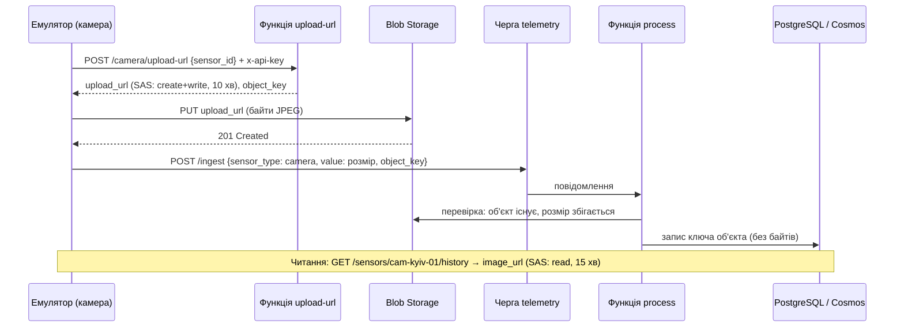

# Бінарні дані в об'єктному сховищі

## Що зроблено

Четвертий датчик, **камера** `cam-kyiv-01`, раз на 15 секунд надсилає знімок (JPEG, 40–65 КБ, ліміт 1 МБ). Зображення не йде ні через чергу, ні в базу:

- знімки лежать у приватному контейнері `camera` окремого акаунта сховища `stmedia…` (`terraform/media.tf`); публічний доступ вимкнено, а правило життєвого циклу видаляє знімки старші за 7 днів;
- функція `cameraUploadUrl` (`POST /api/camera/upload-url`) видає одноразовий підписаний URL на запис;
- у черзі й базі зберігається лише **ключ об'єкта** (`camera/cam-kyiv-01/2026-11-25T11-52-22-536Z.jpg`) і розмір;
- запит історії для камери повертає `image_url` із підписом **на читання на 15 хвилин**.

## Послідовність дій



Обробка камери (`functions/src/lib/processing.js`): функція перевіряє, що об'єкт справді є в сховищі й розмір збігається з повідомленням. Інакше запис позначається аномалією `object_missing` або `size_mismatch`.

## Чому бінарні дані не передають через чергу і не зберігають у базі

**Черга:**
- повідомлення Service Bus обмежені розміром (256 КБ на тарифі Basic/Standard), тож знімок 1 МБ просто не влізе;
- черга призначена для коротких подій, що швидко проходять; мегабайти в черзі сповільнюють усіх споживачів, а при повторній доставці копіюються знову.

**База:**
- зображення роздувають таблиці й резервні копії, сповільнюють бекап і реплікацію;
- кожне читання знімка займало б з'єднання з базою і її пам'ять, а база найдорожчий ресурс системи;
- база не вміє віддавати файли напряму клієнтам, тож усі байти йшли б через функцію.

**Об'єктне сховище** створене саме для цього: дешеве зберігання за ГБ, необмежений обсяг, надійність, віддача файлів напряму по HTTP і правила життєвого циклу.

## Що таке підписаний URL

Це звичайна адреса об'єкта, до якої додано параметри доступу й підпис (у Azure: SAS, shared access signature), наприклад:

```
https://stmedia….blob.core.windows.net/camera/camera/cam-kyiv-01/…jpg
  ?sv=…&st=…&se=2026-11-25T12:02:22Z&sr=b&sp=cw&spr=https&sig=…
```

- `sp`: що дозволено (`cw`: створити й записати; `r`: лише читати);
- `sr=b`: діє на один конкретний blob;
- `st`/`se`: з якого й до якого часу (запис: 10 хв, читання: 15 хв);
- `sig`: підпис ключем акаунта, який знає лише функція. Змінити будь-який параметр без ключа неможливо.

Переваги: емулятор не отримує ключа акаунта й не може записати нічого, крім одного файла; байти йдуть напряму в сховище, не навантажуючи функції; посилання на читання само «протухає».
